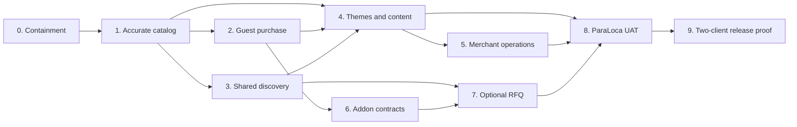

# EcomOS execution plan, 2026-10-10

Build a reusable guest-first WooCommerce platform, prove it on two independent clients, then release ParaLoca with its optional separate RFQ workflow.

The owner approved this local-development execution order on 2026-10-10; see APPROVAL.md. It does not certify new application completion or supersede approval requirements for plugins, purchases, messaging or production. [Run audit](../docs/ecomos/AUDIT_2026-10-10.md) explains the evidence limits.

## Start here

1. Read the audit and [tracking instructions](TRACKING.md).
2. Run `node .ultraplan/scripts/status.mjs` from Ecom-os for current progress.
3. Review the new ECO-102 submission and coordinate explicit follow-ups for its residual acceptance gaps. Work in small claimed slices with independent exact-SHA verification.
4. Use [active sections](sections/index.md) for executor instructions and [active-plan.json](active-plan.json) for requirements, file scopes and dependency graph.

The active plan contains **51 sections, 170 atomic/checkpoint tasks, all 58 original ECO work units and 59 mapped requirements**. The 170 slices are a planning decomposition, not a replacement live task board. Existing historical section files are preserved and superseded for execution.

## What the current run actually establishes

At audited commit `cb80332`, the hub records **9/58 owner ECO units accepted**, comprising ECO-001..008 and ECO-101. HUB-001 and planning/governance work are excluded from that application denominator. Gate 0 is recorded at `7aeba6c`; this is a recorded containment milestone, not production readiness.

Fresh audit unit run: **125 tests passed in 16 files**. A separate targeted reviewer reran 29 of those tests. No fresh full build, live backend transaction or browser checkout was performed by this audit. Independent execution provenance and actual production-server/browser proof need repair. Historical backend COD order #15 remains useful synthetic evidence.

During this audit another runner submitted ECO-102 at `9200763` and recorded acceptance by 12:10 UTC; integrated documentation HEAD became `d805555`. Current recorded progress is **10/58 accepted, Core 10/44, RFQ 0/7, ParaLoca 0/7**, with Phase 1 still ungated. This audit does not automatically certify that newer acceptance; residual connection/price/query/live-fixture requirements remain before the Phase 1 exit gate.

## The three deliverables

**CORE_GUEST:** accurate reusable catalog and discovery, canonical guest cart/shipping/tax/COD/order access, validated theme/client profile, CMS/SEO, native staff operations, reliable provisioning/restore and independent second-client proof.

**CORE_PLUS_ADDONS:** compatible optional modules with complete enabled/disabled behavior. RFQ has a separate basket, guest ownership, immutable offers and duplicate-safe optional conversion into Woo orders. Customer accounts remain a future optional addon, off today.

**PARALOCA:** French, MAD, Moroccan addresses/delivery policy, approved light client design, real catalog/content and owned brands in the same B2C cart, discreet accepted RFQ and client UAT. Every client has its own deployment, WordPress, database and secrets.

WooCommerce owns money, currency, stock, tax, shipping, orders and payment state. Themes/client metadata cannot change those rules. Browser totals are provisional. Uncertified Stripe/CMI remain disabled. Native/hybrid WordPress administration is the selected model.

## Execution sequence and phase exit evidence

### 0. Reconcile the rescue evidence, ECO-001..008

Keep recorded acceptance history. Reproduce decisive checks on an actual clean/detached integrated checkout, recording checkout SHA/path, commands, versions and redacted outputs. Separate unit/mock, live backend, browser and operations proof. Run an actual built Next server/browser matrix for nonce/CSP/hydration, assets, dotted disabled-account paths, private responses and revalidation. Record unresolved advisory exposure and historical staging labels.

**Exit condition:** no known exploitable enabled identity/payment path; bounded containment proof is honest. Any reproduced exposed P0 stops feature activation until fixed. Missing runtime evidence withholds runtime/release certification rather than being silently promoted to PASS.

### 1. Make the catalog correct, ECO-101..105

Specify canonical aliases/unknown inventory/variable money/brand cardinality before accepting dependent mapping. Finish ECO-102 in six small slices: installed schema, explicit failures, complete taxonomy/relationships, exact variation identity, money/media, reversible fixtures. ECO-103 handles query/filter/sort/page metadata and public cache boundaries; ECO-105 handles native brand capability; ECO-104 wires reusable accessible PLP/PDP/category consumers and exact buy intents.

**Exit condition:** **at least 100 mixed simple/variable products**, pages beyond 20, truthful money/currency/stock, exact variation/SKU, category hierarchy, slugs/related items and gallery fallback match backend truth. Include empty, removed and failed-upstream cases. If full traversal is promised, challenge fixed limits with **more than 50 variations on one product and more than 100 categories**. Unit mocks alone cannot pass this real-data gate.

### 2. Complete an actual guest purchase, ECO-201..206

Order: isolated Woo Cart-Token session → exact authoritative cart lines → validated destination/shipping/tax quote → durable COD attempts and browser confirmation → owned guest status. Optional provider certification is separate; COD may remain the only enabled provider. Do not globally disable Store API nonces, cache private carts or assume a generic upstream idempotency header.

**Exit condition:** browser → BFF → Woo produces a real confirmed guest COD order with **two products including an exact variation**, a configured shipping rate, correct tax/total and mail-sink proof. Sequential/concurrent submit, repricing/stock failure and timeout-after-order recovery create no duplicate order or false success. No account is required. A checkout draft ID is insufficient.

### 3. Share accurate discovery, ECO-301..305

Choose a search provider by a representative measured comparison, not habit. Normalize only public documents, rank exact SKU without reference typo rewriting, synchronize updates/deletes with durable retry/rebuild, and deliver accessible suggestions plus URL-synchronized facets used by shop and RFQ.

**Exit condition:** exact SKU, French accent/name typo, combined brand/category/availability/attribute facets, nonrepeating paging and accessible mobile/keyboard paths work. Update/delete lag and p95 latency are measured under a reproducible load, then agreed; no old invented target is claimed proven.

### 4. Separate reusable presentation and content, ECO-401..406

Resolve theme/profile precedence, validate client capabilities and server-only environment boundaries, render WordPress-managed content, improve shared accessible shopping templates and truthful canonical/SEO policy, then demonstrate a contrasting neutral theme.

**Exit condition:** logo/colors/type/navigation/locale/addon presentation change through profiles without adapter edits. CMS edits work without code; structured offers match Woo. Two themes pass common commerce behavior. Extra locales/RTL are conditional capabilities, not mandatory ParaLoca launch scope.

### 5. Make merchant work usable, ECO-501..504

Define staff roles/jobs, evaluate native WP versus one admin enhancement, implement a small capability-scoped Operations landing using Woo CRUD, then verify product/stock/order/content jobs and publish merchant/platform runbooks.

**Exit condition:** manager edits products/stock, processes a sample order and changes homepage content. Non-admin cannot access secrets/settings. Disabled addon has no navigation or API privileges. No competing admin shells or duplicate Next merchant backoffice.

### 6. Prove addon compatibility and lifecycle, ECO-601..604

Version manifests/dependencies/API ranges/config, authoritative server registry and public capability projection, reversible activation/migrations/deactivation, then an exemplar with on/off and failure-isolation tests.

**Exit condition:** routes, frontend slots, staff permissions and side effects agree with capability state. Repeated/failed lifecycle operations recover; disabling preserves core order/catalog data and core purchase.

### 7. Deliver the optional separate RFQ module, ECO-701..707

Start with permission/state/privacy policy. Quote basket and backend strategy can be designed in parallel after that contract; backend persistence precedes live submit. Then add idempotent guest review/submit, immutable staff offers, private PDF/mail, owned guest responses, optional duplicate-safe conversion and full off-state isolation.

**Exit condition:** guest chooses **at least three items via two entry paths**, changes quantities and sends one request; staff sends an immutable offer; verified guest responds and accesses a protected PDF. Old revisions/expired/wrong-owner access fail, retries do not duplicate requests/orders, and normal cart remains untouched. Quote acceptance does not imply reservation or payment.

### 8. Deliver ParaLoca through configuration, ECO-801..807

Create French/MAD/Morocco profile, apply approved client visuals, compose real homepage/catalog/PDP/brands/cart/checkout/favorites/guides, add optional owned-brand stories in the single catalog, enable accepted RFQ discreetly, approve sensitive client content, then run French mobile/desktop UAT.

**Exit condition:** buy/search/quotes use real test records and reusable services; medical/legal/warranty/importer claims have client evidence. No ParaLoca business constants in generic packages. Synthetic staging tax/shipping is never treated as merchant-approved policy. Keep Coming Soon until authorized cutover.

### 9. Prove cross-client release and operations, ECO-901..906

Run exact-commit CI/browser/security/accessibility/performance gates, supported PHP/Woo/GraphQL/HPOS upgrade matrix, independent provisioning, monitored errors and tested restore/rollback. Provision a separate neutral client with RFQ/accounts off and run unchanged buying E2E. Publish actual compatibility/extension docs and concrete release packet.

**Exit condition:** **two independently deployed clients** pass the common commerce suite, addon on/off is real, backups restore and rollback is rehearsed. Production domain/payment certification/content/policy and unresolved-risk decisions are documented. **Explicit operator launch approval is required.** No deployment follows planning or a hub acceptance automatically.

## Parallel work without collisions

Actual hub prerequisites remain authoritative: `0→1; 1→2,3; 1+2+3→4; 4→5; 2→6; 3+6→7; 4+5+7→8; 8→9`. These include the hub's stricter Phase 8 merchant prerequisite. The plan adds necessary intra-phase contract dependencies; it never weakens the hub.

With four provider slots including the coordinator, normally run **two implementers and one verifier**. Catalog A, commerce B, experience C and platform D are routing lanes, not four agents that must run simultaneously. Reserve verification capacity, serialize shared contracts/Git/build/staging/browser resources and prefer isolated worktrees. Read-only research/test design can precede gates; feature activation and accepted implementation cannot skip them.

After Phase 1, guest commerce and search can progress in parallel under disjoint claims. After Phase 2, addon infrastructure can proceed alongside remaining search/presentation work where prerequisites allow. Final release follows actual acceptance, not fixed dates.

## Decisions, only when their evidence is ready

- **D-01, merchant/operator:** actual gateway and certification. Blocks that provider activation, not COD catalog work.
- **D-02, merchant:** real shipping zones/rates, address fields and tax policy. Blocks merchant checkout/release certification; synthetic tests may continue.
- **D-03, operator:** durable checkout attempt storage and transactional email provider/sink. Prove an implementation before checkout activation; no outgoing sending service is assumed authorized.
- **D-04, owner/operator:** search provider/cost/license and measured performance/freshness budgets. Native fallback remains possible; purchases require approval.
- **D-05, owner/operator:** native admin or one evaluated shell. Additional deployed plugin approval is not covered by prior three-plugin authorization.
- **D-06, merchant/operator:** quote backend, ownership verification, expiry/retention/contact consent, conversion/reservation policy. Blocks affected quote activation.
- **D-07, client:** actual medical/legal/warranty/importer content evidence. Blocks unsupported publication.
- **D-08, owner/operator:** exact production target, release risk signoff and cutover. Blocks launch, never inferred from staging permission.

## What counts as progress

The hub owns task status. Report **Core 9/44, RFQ addon 0/7, ParaLoca 0/7 recorded accepted units** at the audit snapshot, not a fabricated readiness percentage. Core includes reusable addon infrastructure and cross-client release work. Counts update from the journal through the status command; they do not express equal effort or fresh certification.

Every task evidence report must list completed **slice IDs**, submitted/tested SHA, verifier, commands/results, fixture provenance, evidence class, blockers and rollback. An accepted historical parent does not automatically complete new follow-up slices. A phase needs every required hub unit, governance conditions and integrated checks; unit-test count or files alone never suffice.

Next execution handoff: orchestrator reviews the newly accepted ECO-102 against the six catalog slices and coordinates residual follow-ups before the Phase 1 gate. ECO-103 remains the next original open unit; no competing ECO-102 assignment is created. Owner approval confirms ordering; scoped open decisions still require their own evidence and decisions; it does not authorize production or paid changes.
