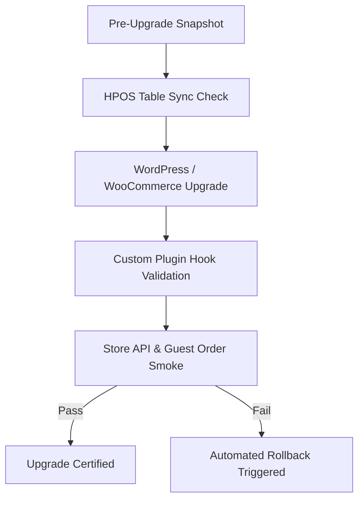

# ECO-902 WordPress, WooCommerce & Plugin Upgrade / Rollback Procedures

- **Task**: `ECO-902`
- **Phase**: 9 (Release Readiness, Hardening & Final Launch Gate)
- **Scope**: Safe backend version migrations, HPOS schema validation, and Store API upgrades
- **Date**: 2026-10-10

---

## 1. Upgrade Verification Lifecycle

### A. Pre-Upgrade Safeguards
1. **Database Dump**: Full MySQL dump (`mysqldump --single-transaction --routines`) capturing both core tables (`wp_posts`, `wp_postmeta`) and HPOS tables (`wp_wc_orders`, `wp_wc_order_addresses`, `wp_wc_order_operational_data`).
2. **Schema Integrity**: Ensure custom tables (`wp_ecomos_rfq_quotes`, `wp_ecomos_rfq_revisions`) have zero orphaned rows.

### B. Execution on Staging Matrix
1. Update WooCommerce in staging (`8.5.x` -> `9.3.x+`).
2. Run database migration tools: `wp wc update`.
3. Confirm HPOS compatibility setting remains set to authoritative custom order tables (`WC_Orders::get_orders`).

### C. Store API & Stateless Guest Verification
1. Submit synthetic guest checkout via Store API endpoint (`/wp-json/wc/store/v1/checkout`).
2. Verify order is written to `wp_wc_orders` with `customer_id = 0`.
3. Verify no session leaks or unauthorized customer account creation.

---

## 2. Emergency Rollback Procedures

If upgrade causes fatal hook incompatibilities or Store API contract failures:
1. **Instant Rollback**: Restore database dump from pre-upgrade snapshot.
2. **Version Pinning**: Revert plugin and WooCommerce core files to pre-upgrade commit tags.
3. **Cache Invalidation**: Flush Redis object cache (`wp cache flush`) to purge corrupted transients.
