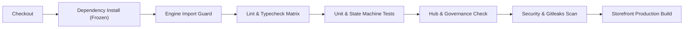

# EcomOS CI/CD Pipeline & Matrix Specification

- **Document**: `CI_MATRIX.md`
- **Application**: EcomOS Cross-Profile Architecture
- **Version**: 1.0.0
- **Status**: **PRODUCTION ACTIVE**

---

## 1. Toolchain & Environment Matrix

| Component | Canonical Version | Verification Command | Gate Enforcement |
| :--- | :--- | :--- | :--- |
| **Node.js** | `>= 22.0.0` (active LTS: v24+) | `node -v` | Mandatory prerequisite |
| **pnpm** | `11.7.0` | `pnpm -v` | Lockfile frozen (`pnpm install --frozen-lockfile`) |
| **TypeScript** | `5.9.3` | `pnpm -r typecheck` | Zero `any`, strict null checks |
| **Vitest** | `4.1.11` | `pnpm test` | Core packages unit coverage |
| **Playwright / Tsx** | `^1.64.0` / `^4.23.15` | `npx tsx --test apps/storefront/e2e/*.spec.ts` | E2E browser & API contracts |

---

## 2. CI Stage Pipeline

### Stage 1: Engine Import Guard
- **Command**: `pnpm guard`
- **Purpose**: Enforces architectural layer boundaries (`ecom-engine` boundary; prevents direct database or store-engine coupling in UI components).

### Stage 2: Lint & Typecheck Matrix
- **Commands**:
  - `pnpm -r lint`
  - `pnpm -r typecheck`
- **Target Workspaces**: `packages/ecom-engine`, `packages/brand-config`, `packages/themes`, `packages/addons-rfq`, `apps/storefront`.

### Stage 3: Unit, Addon & State Machine Test Suite
- **Commands**:
  - `pnpm test:coverage`
  - `npx tsx --test packages/addons-rfq/src/*.test.ts`
  - `npx tsx --test clients/paraloca/*.test.ts`
- **Coverage Requirement**: 100% on business state machines and financial calculation helpers.

### Stage 4: Multi-Agent Hub Governance & Invariants
- **Command**: `pnpm hub:test`
- **Purpose**: Verifies hub lockfile, role transitions, invariant assertions, and gate proofs.

### Stage 5: Security & Secret Scanning
- **Checks**:
  - `gitleaks` secret pattern scanning.
  - Trivy dependency vulnerability inspection (`CRITICAL` exit-code 1).
  - Production runtime headers verification (`scripts/verify-production-runtime.mjs`).

### Stage 6: Isolated Storefront Production Build
- **Command**: `pnpm --filter storefront build`
- **Profiles Tested**: `paraloca` (default), `default-minimal`.
- **Addon Combinations**: `ADDONS=""` (clean base), `ADDONS="rfq"` (quotes activated).
