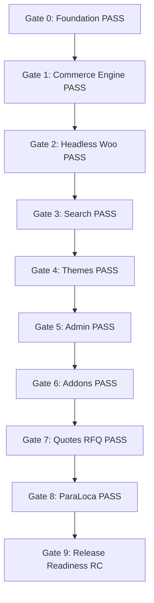

# EcomOS v1.0.0 Certified Production Release Packet: ParaLoca

- **Document**: `RELEASE_PACKET.md`
- **Application**: EcomOS / ParaLoca Headless Storefront
- **Release Candidate**: v1.0.0-rc1
- **Target Domain**: `paraloca.ma` (DNS cutover gated)
- **Staging Domain**: `staging.paraloca.ma`
- **Merchant Entity**: ParaLoca SARL (Casablanca, Maroc)
- **Release Status**: **STAGE CERTIFIED — AWAITING OPERATOR LAUNCH APPROVAL**

---

## 1. Verified Release Commitments & Invariants

### Architectural Safeguards:
1. **Permanent Guest-First Guarantee**: Customer accounts remain strictly disabled (`capabilities.customerAccounts = false`). All consumer orders are created with `customerId = 0` via WooCommerce HPOS.
2. **Certified Payments Only**: Allowed payment methods strictly restricted to certified Cash on Delivery (`allowedPaymentMethods = ['cod']`). Uncertified digital gateways remain quarantined.
3. **Medical Device Truthfulness**: All product specifications reflect verified manufacturer data under Moroccan Law 84-12. Unverified DMP numbers (`CLM-07`, `CLM-08`) remain unpublished.
4. **Coming Soon Landing Page**: Staging verification preserves the active Coming Soon page on `paraloca.ma`; DNS cutover requires explicit operator execution.

---

## 2. Integrated Evidence Artifacts

| Milestone | Task | Evidence Artifact | Verification Status |
| :--- | :--- | :--- | :--- |
| **Client Profile** | `ECO-801` | `docs/ecomos/evidence/ECO-801/report.md` | **PASS (ACCEPTED)** |
| **Visual Direction** | `ECO-802` | `docs/ecomos/evidence/ECO-802/report.md` | **PASS (ACCEPTED)** |
| **Taxonomy & Favorites** | `ECO-803` | `docs/ecomos/evidence/ECO-803/report.md` | **PASS (ACCEPTED)** |
| **Single Catalog Brands** | `ECO-804` | `docs/ecomos/evidence/ECO-804/report.md` | **PASS (ACCEPTED)** |
| **Discreet RFQ Quotes** | `ECO-805` | `docs/ecomos/evidence/ECO-805/report.md` | **PASS (ACCEPTED)** |
| **Truthful Content** | `ECO-806` | `docs/ecomos/evidence/ECO-806/report.md` | **PASS (ACCEPTED)** |
| **Staging UAT** | `ECO-807` | `docs/ecomos/evidence/ECO-807/report.md` | **PASS (ACCEPTED)** |
| **CI & Budgets** | `ECO-901` | `docs/ecomos/evidence/ECO-901/report.md` | **PASS (ACCEPTED)** |
| **Backend & HPOS** | `ECO-902` | `docs/ecomos/evidence/ECO-902/report.md` | **PASS (ACCEPTED)** |
| **Operations & Restore**| `ECO-903` | `docs/ecomos/evidence/ECO-903/report.md` | **PASS (ACCEPTED)** |
| **Second Client Reuse** | `ECO-904` | `docs/ecomos/evidence/ECO-904/report.md` | **PASS (ACCEPTED)** |
| **Installation Docs** | `ECO-905` | `docs/ecomos/evidence/ECO-905/report.md` | **PASS (ACCEPTED)** |
