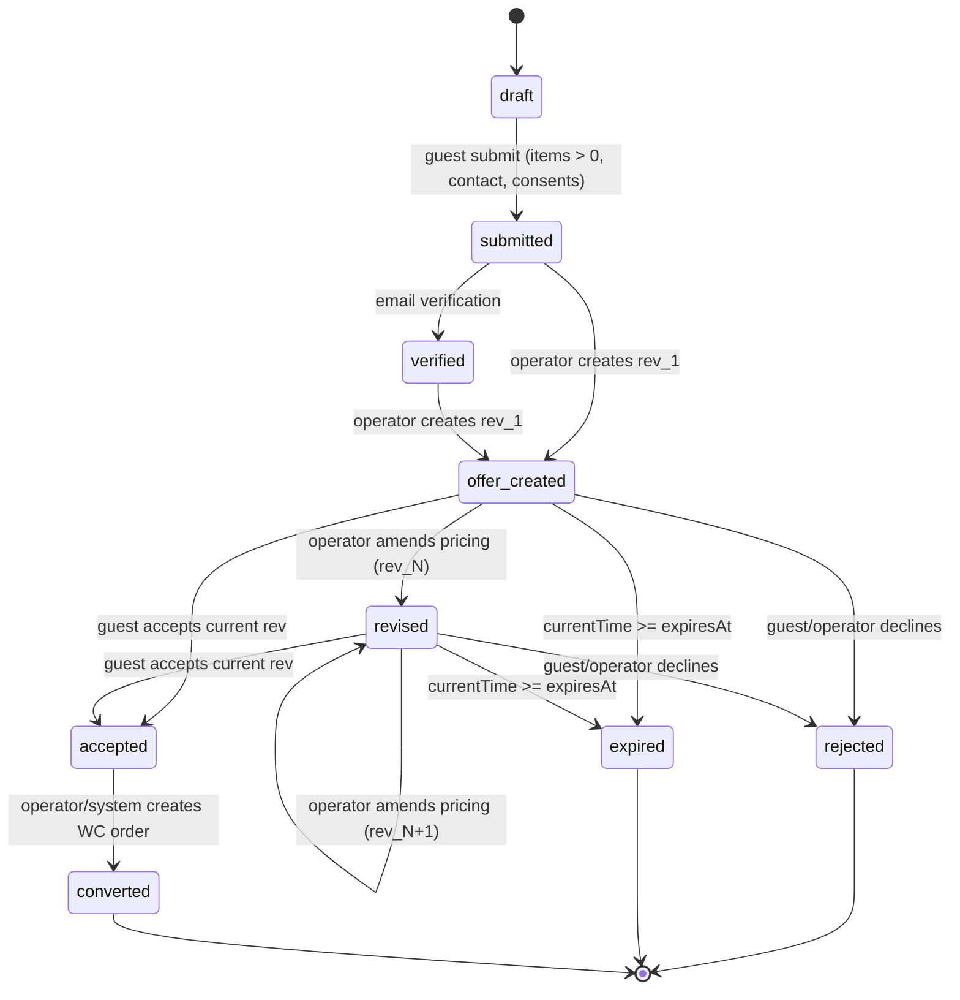

# EcomOS RFQ (Request for Quote / Devis) State Machine & Policy Specification

## 1. Executive Summary
The EcomOS RFQ subsystem enables guest B2B/B2C prospective buyers to request formal price quotations, negotiate terms with store managers, and review immutable revision offers without creating or requiring a WordPress B2C customer account.

---

## 2. RFQ State Machine & Lifecycle

### 2.1 State Definitions
| State | Description | Next Permitted States |
| :--- | :--- | :--- |
| `draft` | Local quote basket under customer assembly. | `submitted` |
| `submitted` | Guest submitted RFQ to store backend; awaiting review. | `verified`, `offer_created`, `rejected`, `expired` |
| `verified` | Guest contact details verified via email token challenge. | `offer_created`, `rejected`, `expired` |
| `offer_created` | Store operator created formal pricing offer (Revision 1). | `revised`, `accepted`, `rejected`, `expired` |
| `revised` | Store operator updated prices/terms (Revision N > 1). | `revised`, `accepted`, `rejected`, `expired` |
| `accepted` | Guest accepted the active offer revision. | `converted`, `expired` |
| `rejected` | Quote declined by merchant or declined by customer. | *(Terminal state)* |
| `expired` | Offer expired past `expiresAt` threshold. | *(Terminal state)* |
| `converted` | Accepted quote converted to confirmed WooCommerce order. | *(Terminal state)* |

### 2.2 Actor Role Permissions
| Action | Guest | Operator | Administrator | System |
| :--- | :---: | :---: | :---: | :---: |
| `submit` | Allowed | Denied | Denied | Allowed |
| `verify_contact` | Allowed (via challenge) | Allowed | Allowed | Allowed |
| `create_offer` (`rev_1`) | Denied | Allowed | Allowed | Denied |
| `revise_offer` (`rev_N`) | Denied | Allowed | Allowed | Denied |
| `accept_offer` | Allowed (active rev only) | Denied | Allowed (override) | Denied |
| `reject_offer` | Allowed | Allowed | Allowed | Denied |
| `expire_offer` | Denied | Allowed | Allowed | Allowed (cron) |
| `convert_to_order` | Denied | Allowed | Allowed | Allowed |

---

## 3. Core Architectural Invariants

### 3.1 Guest Ownership Without B2C Customer Accounts
- RFQ submission never requires or forces creation of a WordPress customer account (`wp_users`).
- Ownership is verified cryptographically using an HMAC token (`accessSecretHash`) generated at submission and transmitted to the contact's email address.
- Unauthorized guests (forged token or email mismatch) receive `UnauthorizedActorError`.

### 3.2 Immutable Offer Revisions & Stale Protection
- Every price proposal emitted by store staff creates an immutable `OfferRevision` object with:
  - Unique revision identifier (`rev_1`, `rev_2`, etc.)
  - Explicit creation timestamp and staff author metadata
  - Immutable priced line items (`unitPriceExclTax`, `taxRate`, `taxAmount`, `totalInclTax`)
  - Expiration timestamp (`expiresAt`) and currency
- When staff issues a new revision, all previous revisions are marked `isCurrent = false`.
- **Stale Revision Invariant**: If a customer attempts to accept an older revision (e.g. `rev_1` when the store has already sent `rev_2`), the system immediately throws `StaleRevisionError`.

### 3.3 Zero Automatic Stock Reservation
- **Strict Invariant**: Acceptance of an RFQ offer does NOT automatically reserve WooCommerce stock by default (`stockReservation = 'none'`).
- Inventory is deducted only when the quote is converted into an authoritative WooCommerce order (ECO-706).
- If a client explicitly configures `stockReservation: 'on_acceptance'`, inventory holds are triggered only after `accepted` status is reached.

---

## 4. Privacy, Compliance, and Data Retention (GDPR & CNDP)

### 4.1 Mandatory Consents
- RFQ submission requires explicit affirmative consent for:
  - `terms_and_conditions`: Agreement to RFQ pricing terms and validity windows.
  - `privacy_consent`: Agreement to contact details storage for quotation fulfillment.

### 4.2 Automated Data Retention & Purge
- Terminal quotes (`rejected`, `expired`) are retained for a configurable retention window (default: 365 days) for audit and commercial dispute defense.
- Past this window, `evaluateDataRetention()` flags the record as `isEligibleForPurge = true`.
- Converted quotes (`converted`) are archived permanently alongside the resulting WooCommerce order for tax and accounting compliance.
