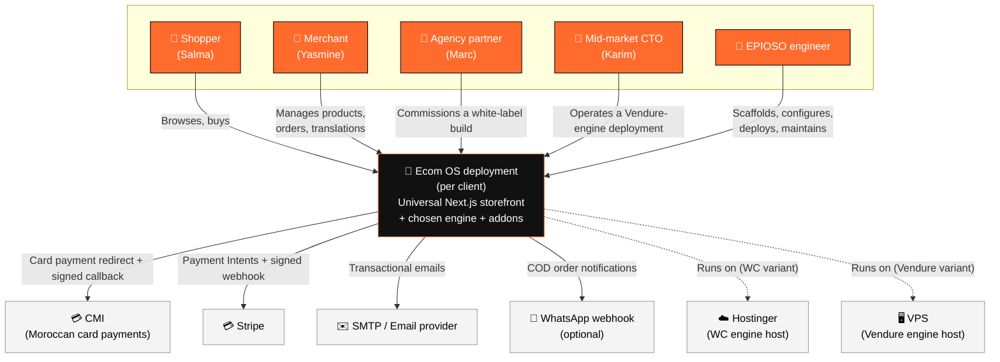
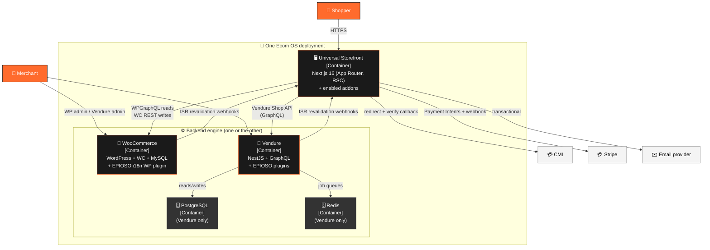
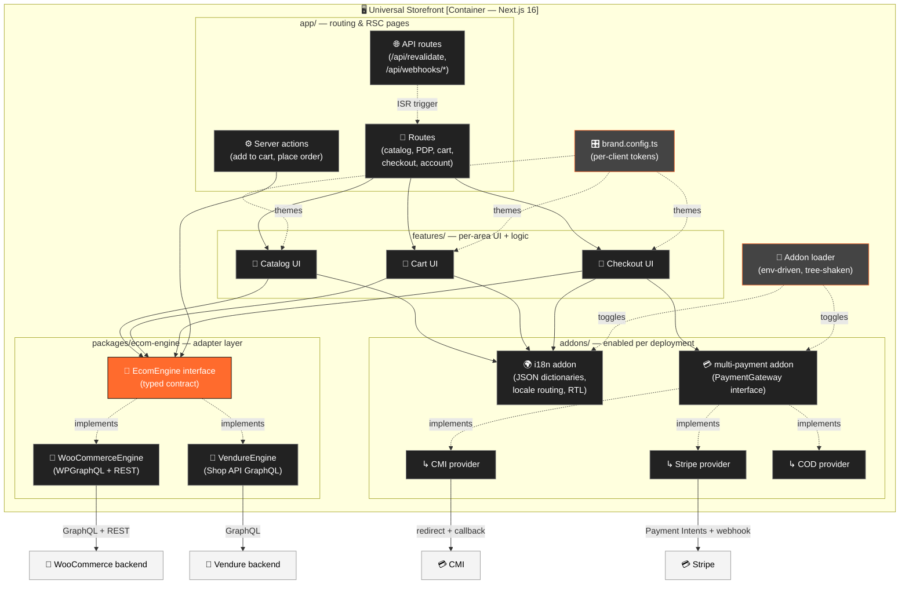

# C4 Diagrams — Ecom OS

Three levels: **Context** (the whole system + its external actors), **Container** (the deployable units), **Component** (internals of the Universal Storefront). All rendered in Mermaid.

---

## Level 1 — System Context

---

## Level 2 — Container (one client deployment)

---

## Level 3 — Component (inside the Universal Storefront)

---

## How to read these diagrams

- **Solid arrows** = synchronous request/call
- **Dotted arrows** = asynchronous or "implements" / "toggles" / "themes"
- **Orange** = persona or interface (the "contracts" of the system)
- **Black/dark** = first-party Ecom OS containers/components
- **Grey** = external services (third party or infra)

Update these diagrams whenever a new addon, engine, or external service is introduced. They are the source of truth for the system shape.
