# Information Architecture — Ecom OS

The IA below is the **default** template shipped with Ecom OS. Per-client deployments can extend it (custom pages, blog, lookbook) but the core spine is fixed so the starter kit can ship reliably.

---

## 1. Sitemap (default storefront)

```mermaid
graph TD
  Root["/ (Home)"]

  Root --> Catalog["/{locale}/catalog<br/>Catalog index"]
  Root --> About["/{locale}/about"]
  Root --> Contact["/{locale}/contact"]
  Root --> Account["/{locale}/account"]
  Root --> Cart["/{locale}/cart"]
  Root --> Legal["/{locale}/legal/..."]

  Catalog --> CategoryPage["/{locale}/catalog/{category-slug}<br/>Category page"]
  CategoryPage --> PDP["/{locale}/products/{product-slug}<br/>Product detail"]

  Cart --> Checkout["/{locale}/checkout"]
  Checkout --> CheckoutAddress["/{locale}/checkout/address"]
  CheckoutAddress --> CheckoutPayment["/{locale}/checkout/payment"]
  CheckoutPayment --> CheckoutConfirm["/{locale}/checkout/confirmation/{orderId}"]

  Account --> Login["/{locale}/account/login"]
  Account --> Register["/{locale}/account/register"]
  Account --> Profile["/{locale}/account/profile"]
  Account --> Orders["/{locale}/account/orders"]
  Account --> OrderDetail["/{locale}/account/orders/{orderId}"]
  Account --> AddressBook["/{locale}/account/addresses"]
  Account --> PasswordReset["/{locale}/account/password-reset"]

  Legal --> Privacy["/{locale}/legal/privacy"]
  Legal --> Terms["/{locale}/legal/terms"]
  Legal --> Cookies["/{locale}/legal/cookies"]
  Legal --> Returns["/{locale}/legal/returns"]

  Root --> SystemPages[" "]
  SystemPages --> NotFound["/404 (not found)"]
  SystemPages --> Error["/500 (server error)"]
  SystemPages --> OfflineSearch["/{locale}/search?q="]

  classDef public fill:#FF6B2D,stroke:#000,color:#fff
  classDef account fill:#1a1a1a,stroke:#FF6B2D,color:#fff
  classDef checkout fill:#333,stroke:#FF6B2D,color:#fff
  classDef system fill:#888,stroke:#000,color:#fff
  class Root,Catalog,CategoryPage,PDP,About,Contact public
  class Account,Login,Register,Profile,Orders,OrderDetail,AddressBook,PasswordReset account
  class Cart,Checkout,CheckoutAddress,CheckoutPayment,CheckoutConfirm checkout
  class NotFound,Error,OfflineSearch,Legal,Privacy,Terms,Cookies,Returns system
```

---

## 2. URL Structure

All public URLs are **locale-prefixed**. The root `/` redirects to the deployment's default locale.

| Pattern | Example | Notes |
|---|---|---|
| `/` | `/` | Redirects to `/{defaultLocale}` |
| `/{locale}` | `/fr`, `/ar`, `/en` | Locale-scoped home |
| `/{locale}/catalog` | `/fr/catalog` | Top-level catalog |
| `/{locale}/catalog/{category-slug}` | `/fr/catalog/shirts` | Category listing |
| `/{locale}/products/{product-slug}` | `/ar/products/abaya-noir` | PDP |
| `/{locale}/cart` | `/fr/cart` | Cart page |
| `/{locale}/checkout` | `/fr/checkout` | Checkout entry |
| `/{locale}/checkout/{step}` | `/fr/checkout/address` | Checkout steps |
| `/{locale}/account` | `/fr/account` | Account hub |
| `/{locale}/account/{section}` | `/fr/account/orders` | Account sections |
| `/{locale}/search?q={query}` | `/fr/search?q=robe` | Search results |
| `/{locale}/legal/{slug}` | `/fr/legal/privacy` | Legal pages |
| `/api/revalidate` | — | ISR webhook (not user-facing) |
| `/api/webhooks/{provider}` | `/api/webhooks/stripe` | Payment webhooks |

### Locale rules
- Default deployment locales: `fr` (primary), `ar` (RTL), `en` (fallback). Override per client in `brand.config.ts`.
- Slugs are **per-locale**: a product can have `/fr/products/robe-rouge` and `/ar/products/فستان-أحمر` pointing to the same product ID.
- 404 and 500 are rendered in the requested locale when detectable, otherwise the default locale.

---

## 3. Navigation Hierarchy

### Primary navigation (header, all viewports)
- Logo → `/{locale}`
- Catalog → `/{locale}/catalog` (mega-menu of categories on desktop; drawer on mobile)
- About → `/{locale}/about`
- Contact → `/{locale}/contact`
- 🔍 Search icon → opens search overlay
- 🌐 Locale switcher → switches the active locale (preserves the current path when possible)
- 👤 Account icon → `/{locale}/account` (or login if signed out)
- 🛒 Cart icon (with item count badge) → `/{locale}/cart`

### Secondary navigation (footer, all viewports)
- **Shop**: links to top categories (data-driven from active categories)
- **Account**: Login, Register, My Orders, Addresses
- **Help**: Contact, Returns, FAQ (if enabled)
- **Legal**: Privacy, Terms, Cookies
- **Locale + currency** (read-only display)
- **Brand**: tagline + social icons (from `brand.config.ts`)

### Account navigation (sidebar within `/account/*`)
- Profile · Orders · Addresses · Password · Logout

### Checkout flow (linear, no nav bar)
Address → Payment → Confirmation. Back button steps backward; no header/footer nav to reduce abandonment.

---

## 4. Content Groupings

Three groups of pages serve different intent:

| Group | Purpose | Pages |
|---|---|---|
| **Browse & decide** | Inspire → narrow → choose | Home, Catalog, Category, PDP, Search |
| **Buy** | Move money | Cart, Checkout steps, Confirmation |
| **Account & service** | Post-purchase + trust | Account hub, Orders, Profile, Addresses, Contact, Legal |

Every page belongs to exactly one group. Per-client extensions (blog, lookbook, journal) live alongside without altering the spine.

---

## 5. Page templates inventory

Five reusable Next.js page templates underlie every storefront route:

| Template | Used by | RSC by default? |
|---|---|---|
| `HomeTemplate` | `/` | Yes |
| `ListingTemplate` | Catalog, Category, Search | Yes |
| `PdpTemplate` | Product detail | Yes |
| `FlowTemplate` | Cart, Checkout steps | Mixed (server shell + client islands) |
| `AccountTemplate` | All `/account/*` pages | Yes (forms are client islands) |
| `StaticTemplate` | About, Contact, Legal pages | Yes |

Each template is a single source file under `apps/storefront/src/templates/`. Per-client brand styling injects via `brand.config.ts` tokens — never via component overrides.
