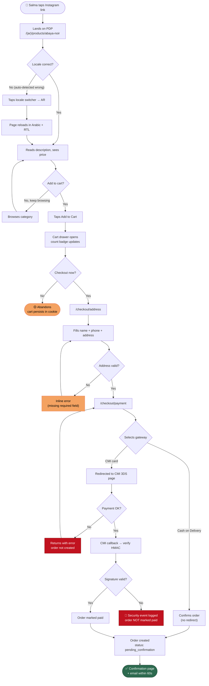
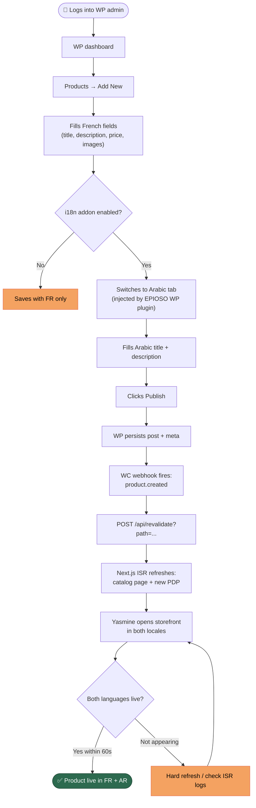
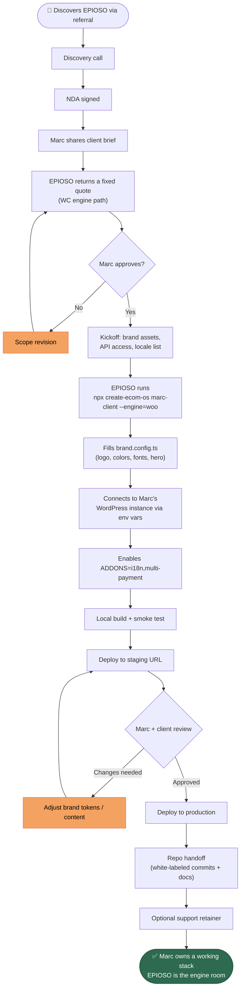
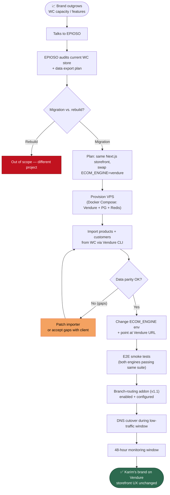

# User Journey Maps — Ecom OS

One journey per persona. Each renders as a Mermaid flowchart with the **success state** (green) and the **failure / drop-off states** (red) called out.

---

## Journey 1 — Salma (end shopper) buys a product

**Entry point:** Instagram link to a product page.

**Critical drop-off points:** cart abandonment, address validation, payment failure. UX must keep these recoverable (cart persistence, inline errors, retry).

---

## Journey 2 — Yasmine (merchant) adds a product with Arabic translation

**Entry point:** WordPress admin login.

**Critical UX requirement:** the AR tab MUST appear directly in the standard product editor, not as a separate page. Switching screens loses merchants.

---

## Journey 3 — Marc (agency partner) commissions a white-label deployment

**Entry point:** First call with EPIOSO sales lead.

**Success metric:** end-to-end (kickoff → production) within 2 weeks. If iteration loops exceed 2 cycles, scope discipline failed at kickoff.

---

## Journey 4 — Karim (mid-market CTO) migrates from WC engine to Vendure engine (v1 → v1.1)

**Entry point:** Karim's brand has outgrown WC; wants more control + multi-branch routing.

**Key UX bet:** Salma-grade shoppers on Karim's storefront SHOULD NOT notice the engine swap. The visual regression suite gates the cutover.

---

## Cross-journey insights

| Insight | Implication for design |
|---|---|
| Locale must be sticky and visible | Persistent locale switcher in header; cookie + URL persist together |
| Cart abandonment is the biggest leak | Cart persists in cookie for 30 days; one-click resume from email |
| Address validation must be inline, not summary-page | Errors render under each field, in the active locale |
| COD is the default in MENA | COD always shown first when enabled; CMI/Stripe second |
| Merchant edits must reflect in ≤60s | Webhook → ISR contract is non-negotiable |
| Migration UX is invisible to shoppers | Visual regression suite is the only test that matters during cutover |
