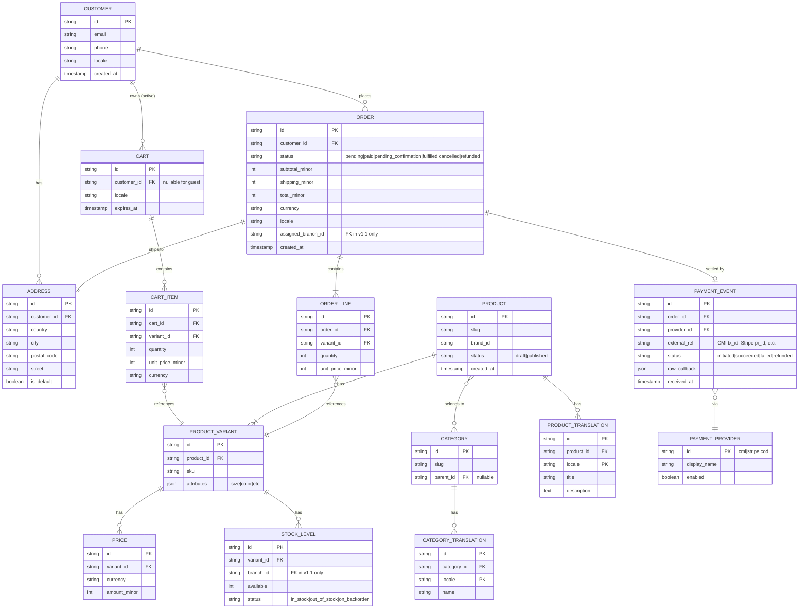
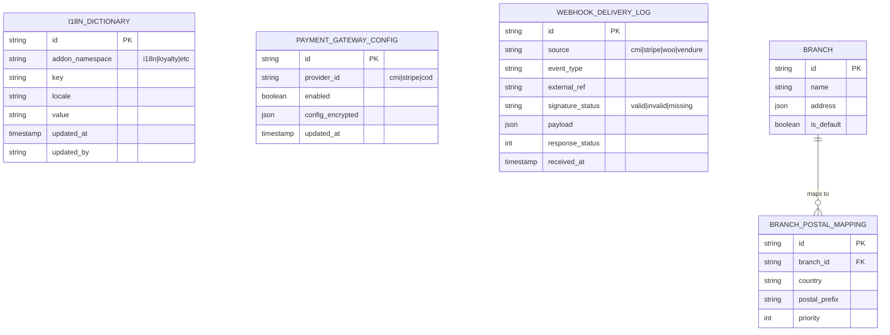

# Entity Relationship Diagram — Ecom OS

This ERD is **engine-agnostic**. It models the conceptual entities the Universal Storefront sees through the `EcomEngine` interface, plus the Ecom-OS-owned tables that addons add on top of either backend. The raw WooCommerce / Vendure schemas are owned by their respective projects and not duplicated here.

---

## 1. Conceptual entity model

### Notes on this model
- All money is stored as **minor units** (e.g., centimes) — never floats.
- `locale` is a composite-key participant on every `*_TRANSLATION` table.
- `assigned_branch_id` on `ORDER` and `branch_id` on `STOCK_LEVEL` are **v1.1** only (multi-branch routing addon). v1 leaves them null.
- `CART` has a TTL via `expires_at` so abandoned carts can be cleaned up by a scheduled job.
- The Universal Storefront never queries this model directly — it goes through `EcomEngine`. The engine adapter is responsible for mapping these concepts onto WC's / Vendure's actual storage.

---

## 2. Ecom-OS-owned addon tables

These tables live in the engine's database (created by WC plugins or Vendure migrations) but are **owned by Ecom OS addons**.

### v1 vs v1.1

| Table | v1 | v1.1 |
|---|---|---|
| `I18N_DICTIONARY` | ✅ shipped with i18n addon | — |
| `PAYMENT_GATEWAY_CONFIG` | ✅ shipped with multi-payment addon | — |
| `WEBHOOK_DELIVERY_LOG` | ✅ shipped with multi-payment addon | extended for all webhooks |
| `BRANCH` | — | ✅ shipped with multi-branch addon |
| `BRANCH_POSTAL_MAPPING` | — | ✅ shipped with multi-branch addon |

---

## 3. Identity & multi-tenancy

There is **no tenant-id** column anywhere. Per ADR-003 (one app per client), each deployment owns its database; cross-tenant isolation is enforced at the infrastructure boundary, not at the data layer.

If multi-tenancy is ever introduced (v2+), a `tenant_id` would be added to every row and every query plus RLS policies. **Not in v1.**
