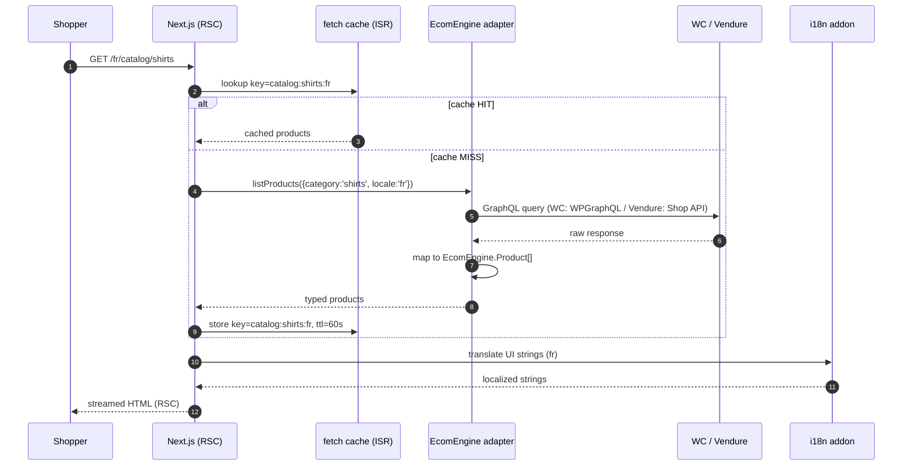
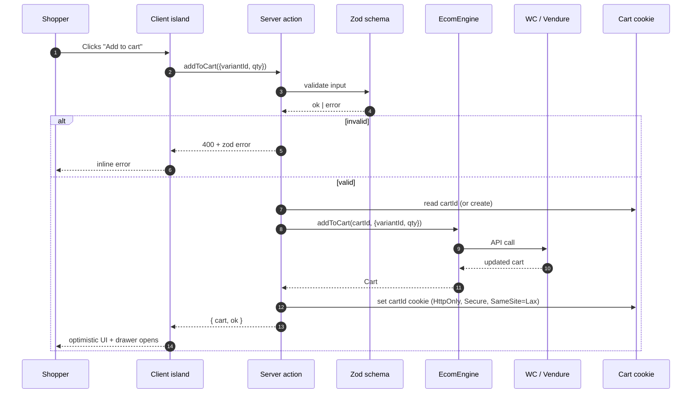
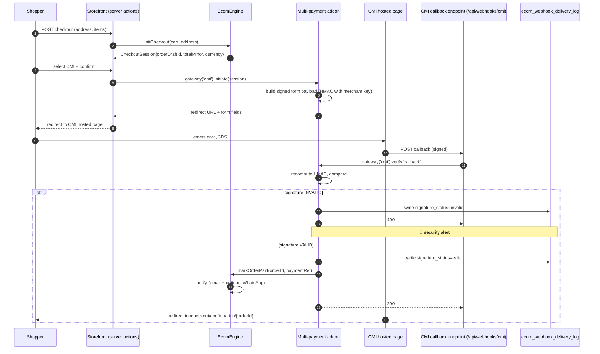
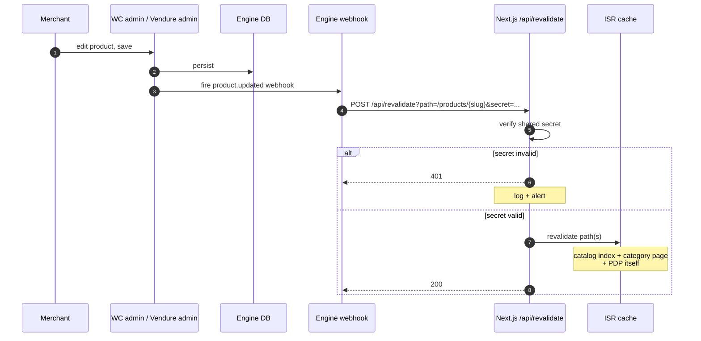
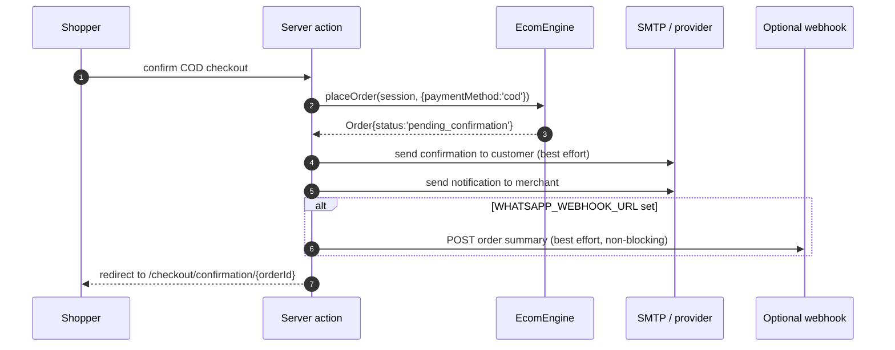

# Data Flow — Ecom OS

Five canonical flows that cover every data movement in v1. Each as a Mermaid sequence/flow diagram with the trust boundary called out.

---

## Flow 1 — Catalog read (RSC → engine → cache → HTML)

**Trust boundary:** Shopper → Edge is untrusted (NFR-032 input validation applies to query params). Edge → Engine → Backend is server-side, credentialed.

---

## Flow 2 — Add to cart (client island → server action → engine)

**Trust boundary:** Client → Server action via Next.js's signed payload; server-side validation is the source of truth.

---

## Flow 3 — Checkout + CMI payment (with HMAC verification)

**Trust boundary:** CMI → callback endpoint is untrusted until HMAC verification succeeds. Order state changes are blocked behind successful verification (NFR-033).

---

## Flow 4 — Merchant updates a product → storefront updates (ISR webhook)

**Trust boundary:** Engine → `/api/revalidate` is untrusted; protected by a shared secret in env var (`REVALIDATE_SECRET`).

---

## Flow 5 — Cash-on-delivery order (no external payment hop)

**Trust boundary:** None to external services for COD itself — order is local. Notifications are best-effort; failure does not block order creation (FR-076).

---

## Cross-cutting data rules

| Rule | Where enforced | Source requirement |
|---|---|---|
| All money stored as minor units (no floats) | Adapter mapping + addon tables | NFR + ERD §1 |
| Webhook signatures verified before any state change | Each webhook handler | NFR-033, FR-074, FR-075 |
| Input from shoppers validated via Zod at server boundary | Server actions + API routes | NFR-032 |
| Locale on every persisted user-facing string | Translation tables + order header | FR-060, ERD §1 |
| No PII in client-side bundles | Build-time check on `apps/storefront/` | NFR-031 |
| Append-only webhook log | `ecom_webhook_delivery_log` table | Schema §2 |
| Cart cookies: HttpOnly, Secure, SameSite=Lax | Server action set-cookie | ADR-006 |

---

## What no flow does in v1

- No flow writes directly to engine-native tables — always via the engine's API.
- No flow keeps state in the Next.js process across requests (no in-memory sessions). Cache is the only in-process state.
- No flow propagates customer-side data to third-party analytics in v1.
